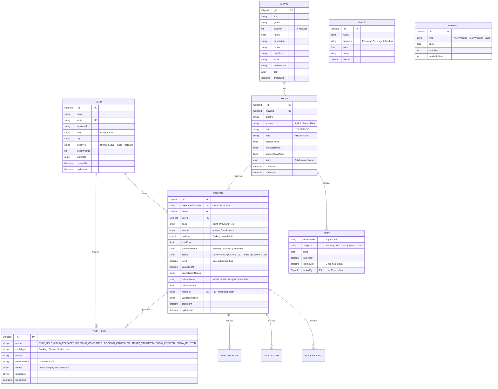

# FlickTicket — Entity Relationship (ER) Diagram & Data Dictionary
**Document Reference**: ALGIONS AI LABS Assessment Package  
**Author**: Lithish Kumar  
**Database**: MongoDB (Mongoose ODM)  
**Schema Architecture**: Document-Oriented with Embedded Subdocuments & Compound Indexes  

---

## 1. Mermaid Entity-Relationship Diagram

---

## 2. Data Dictionary & Field Specifications

### 2.1 `User` Collection
| Field | Type | Required | Constraints | Description |
|---|---|---|---|---|
| `_id` | ObjectId | Yes | Primary Key | Unique user identifier |
| `name` | String | Yes | Trimmed | Customer full name |
| `email` | String | Yes | Unique, lowercase | Authentication email address |
| `password` | String | Yes | Min length 6 | Salted bcrypt hash |
| `role` | String | Yes | Enum: `["user", "admin"]` | Access control tier (Default: `"user"`) |
| `loyaltyTier` | String | No | Enum | CineClub tier: Bronze, Silver, Gold, Platinum |
| `loyaltyPoints` | Number | No | Default: 0 | Redeemable reward points balance |

### 2.2 `Show` Collection & Embedded `Seat` Subdocuments
| Field | Type | Required | Constraints | Description |
|---|---|---|---|---|
| `_id` | ObjectId | Yes | Primary Key | Show identifier |
| `movieId` | ObjectId | Yes | Ref: `Movie` | Associated movie reference |
| `theatre` | String | Yes | Trimmed | Multiplex branch name |
| `screen` | String | No | Default: Audi 1 | Screen auditorium room |
| `date` | String | Yes | Format: `YYYY-MM-DD` | Showtime date |
| `time` | String | Yes | Format: `HH:MM AM/PM` | Showtime slot |
| `balconyPrice` | Number | Yes | Positive integer | Tier price for Balcony seats |
| `firstClassPrice` | Number | Yes | Positive integer | Tier price for First Class seats |
| `secondClassPrice` | Number | Yes | Positive integer | Tier price for Second Class seats |
| `seats` | Array[Seat] | Yes | Subdocument | List of auditorium seat objects |
| `seats.seatNumber` | String | Yes | e.g. "A1", "C6" | Seat row-column coordinates |
| `seats.category` | String | Yes | Enum | `["Balcony", "First Class", "Second Class"]` |
| `seats.price` | Number | Yes | Positive number | Seat pricing in INR |
| `seats.isBooked` | Boolean | Yes | Default: `false` | Permanent booking state |
| `seats.lockedUntil` | Date | No | Default: `null` | Temporary hold expiration timestamp |
| `seats.lockedBy` | ObjectId | No | Ref: `User` | User currently holding the seat lock |

### 2.3 `Booking` Collection
| Field | Type | Required | Constraints | Description |
|---|---|---|---|---|
| `_id` | ObjectId | Yes | Primary Key | Mongo internal booking ID |
| `bookingReference` | String | Yes | Unique index | Human-friendly ticket reference (`CB-2026-XXXXXX`) |
| `showId` | ObjectId | Yes | Ref: `Show` | Show being attended |
| `userId` | ObjectId | Yes | Ref: `User` | Customer owning the reservation |
| `seats` | Array[String] | Yes | Non-empty | Reserved seat numbers (e.g. `["A1", "A2"]`) |
| `totalPrice` | Number | Yes | Positive number | Grand total (Seats + Snacks + Parking) |
| `status` | String | Yes | Enum | `["CONFIRMED", "CANCELLED", "USED", "COMPLETED"]` |
| `used` | Boolean | Yes | Default: `false` | Gate admission flag (Single-use guard) |
| `cancelledAt` | Date | No | Timestamp | When cancellation was triggered |
| `refundStatus` | String | Yes | Enum | `["NONE", "PENDING", "PROCESSED"]` |
| `refundAmount` | Number | No | Equals `totalPrice` | Refunded amount in INR |
| `refundId` | String | No | Unique format | Simulated refund reference (`REF-timestamp-hash`) |
| `validationToken` | String | Yes | Tamper token | Cryptographic or random verification token |

### 2.4 `AuditLog` Collection
| Field | Type | Required | Constraints | Description |
|---|---|---|---|---|
| `_id` | ObjectId | Yes | Primary Key | Audit entry identifier |
| `action` | String | Yes | Enum | Action type (`SEAT_HOLD`, `BOOKING_CONFIRMED`, `BOOKING_CANCELLED`, `TICKET_VALIDATED`, etc.) |
| `entityType` | String | Yes | String | Affected entity: `Show`, `Booking`, `Movie` |
| `entityId` | String | Yes | String | Primary identifier of target entity |
| `performedBy` | String | Yes | String | User ID, admin name, or actor identifier |
| `details` | Object | Yes | Schema-less Map | Payload metadata (seats, prices, refund IDs) |
| `ipAddress` | String | No | IPv4 / IPv6 | Request origin IP address |
| `timestamp` | Date | Yes | Default: `Date.now` | ISO 8601 event timestamp |

---

## 3. Database Indexes for High-Concurrency Performance

| Collection | Index Fields | Type | Purpose |
|---|---|---|---|
| `Show` | `{ movieId: 1, date: 1, theatre: 1 }` | Compound | Fast showtime lookup by movie and theater |
| `Show` | `{ "seats.seatNumber": 1, "seats.isBooked": 1 }` | Compound Subdoc | Atomic concurrency seat availability evaluation |
| `Booking` | `{ bookingReference: 1 }` | Unique Single | Sub-millisecond QR ticket verification lookups |
| `Booking` | `{ userId: 1, createdAt: -1 }` | Compound | Instant customer booking history loading |
| `AuditLog` | `{ timestamp: -1 }` | Single Desc | Reverse chronological audit trail queries |

